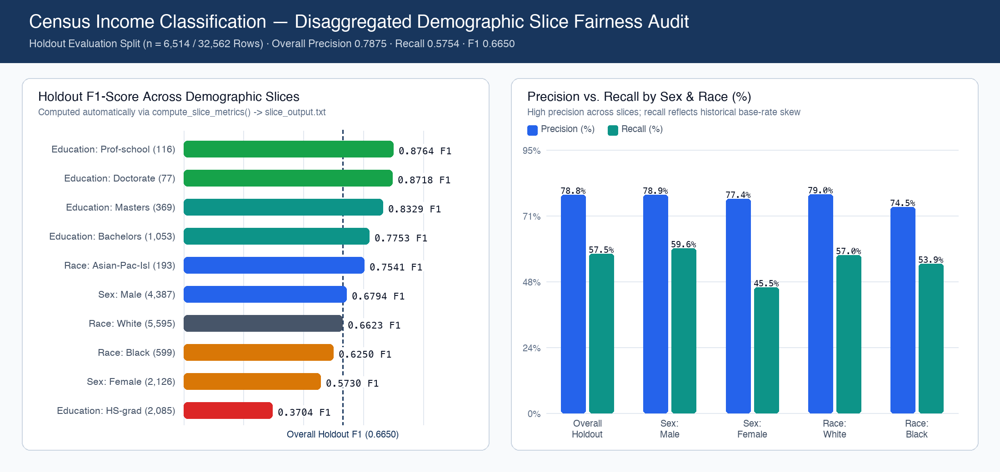
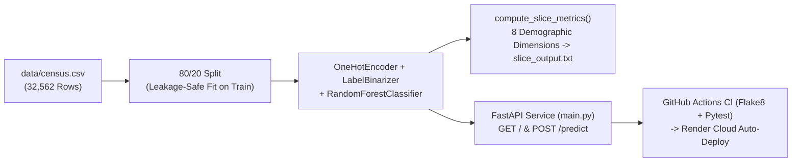
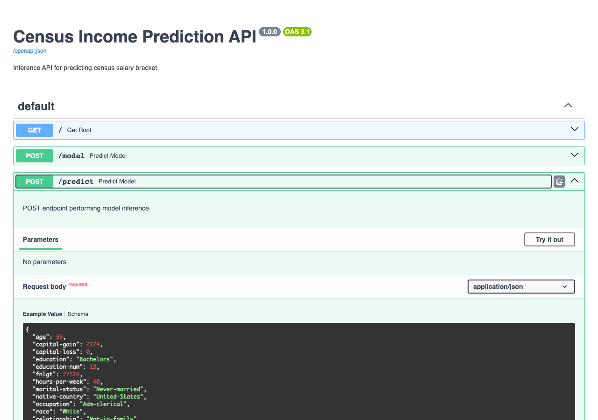
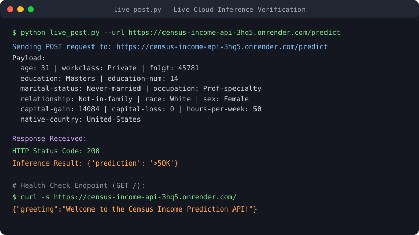
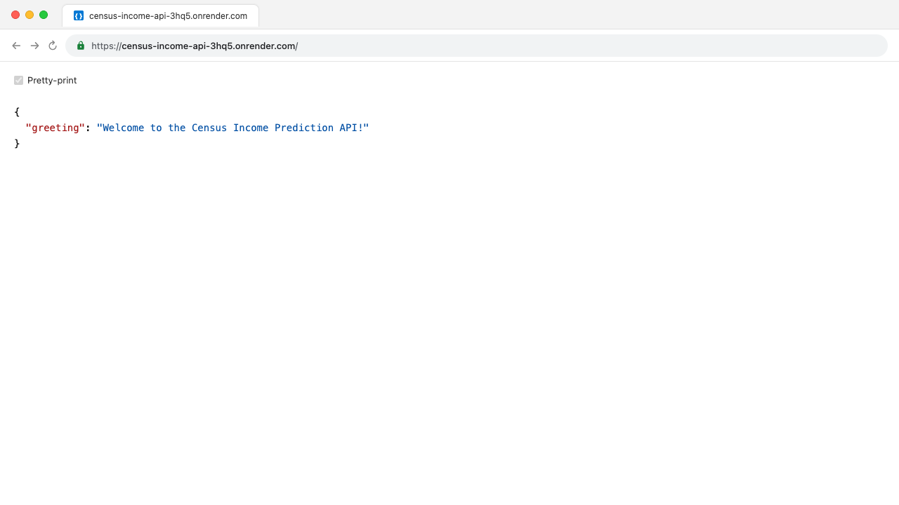
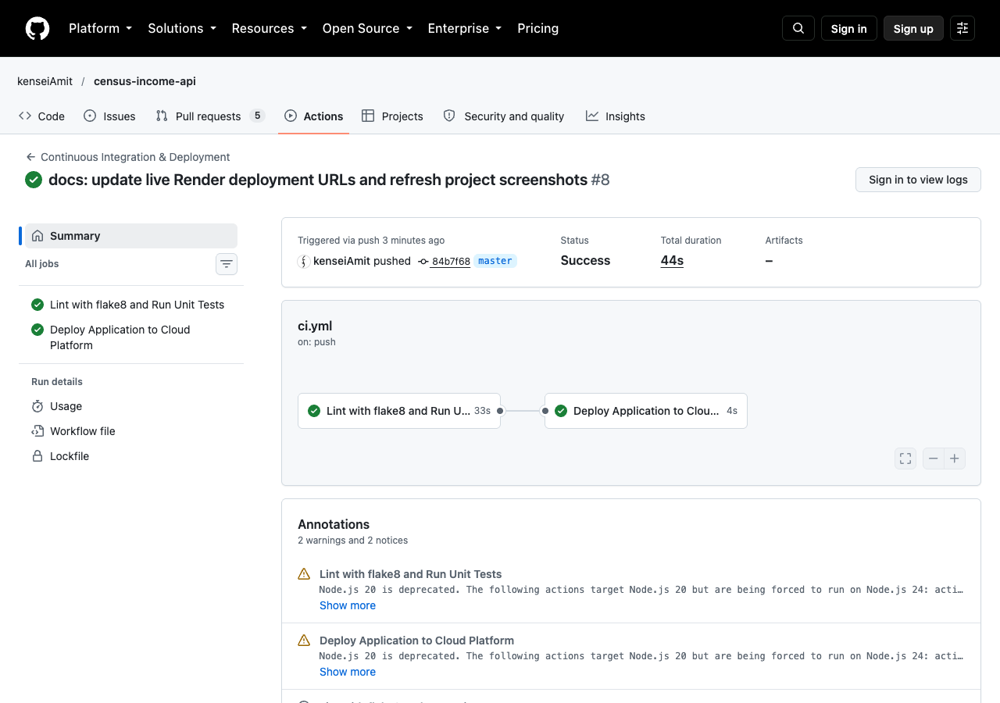
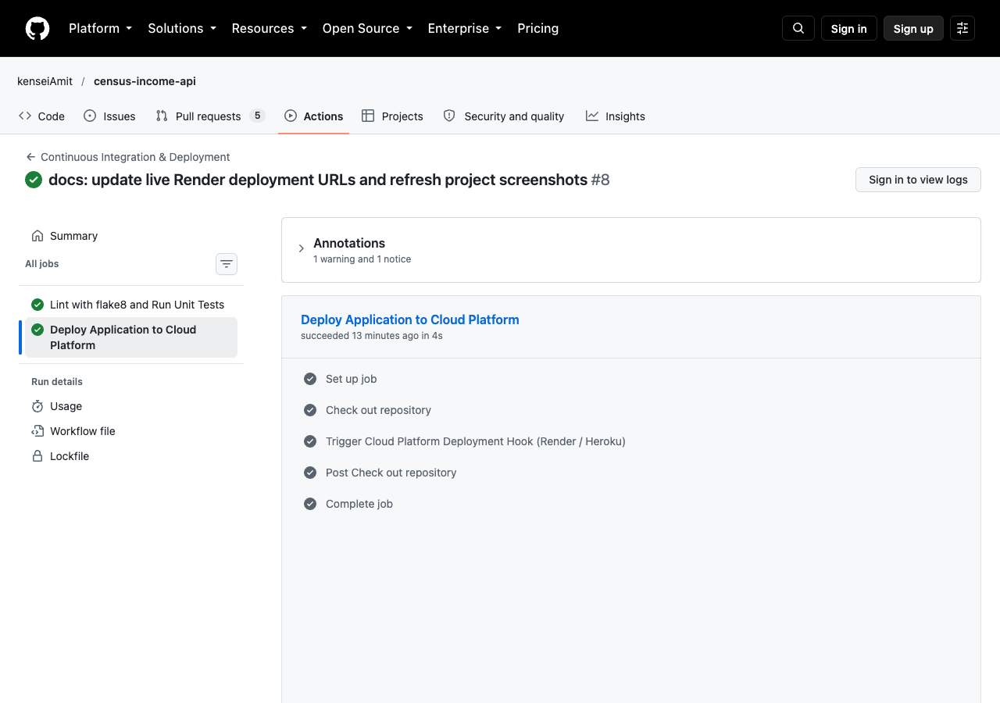

<div align="center">
  
  <br/><br/>
  <p>
    <a href="https://github.com/kenseiAmit/census-income-api/actions/workflows/ci.yml"></a>
    <a href="https://www.python.org/downloads/"></a>
    <a href="https://fastapi.tiangolo.com/"></a>
    
    <a href="LICENSE"></a>
  </p>
  
</div>

---

An end-to-end production Machine Learning service predicting annual income brackets (`>50K` vs `<=50K`) on US Census Bureau demographic data—featuring **leakage-free feature encoding**, **automated demographic slice fairness evaluation**, **FastAPI Pydantic v2 inference**, **Model Card governance**, and **gated CI/CD deployment** (GitHub Actions + Render).

- **Live Cloud Endpoint:** https://census-income-api-3hq5.onrender.com
- **Interactive OpenAPI Docs:** https://census-income-api-3hq5.onrender.com/docs

---

## Architecture & Highlights





- **Leakage-Safe Feature Pipeline (`income_classifier/ml/data.py`):** Fits `OneHotEncoder(handle_unknown="ignore")` and `LabelBinarizer` strictly on training splits and reuses serialized artifacts during validation and real-time API inference.
- **Demographic Slice Fairness Auditing (`income_classifier/ml/model.py`):** Computes Precision, Recall, and $F_1$ across every categorical slice (`workclass`, `education`, `marital-status`, `occupation`, `relationship`, `race`, `sex`, `native-country`)—persisted in [`slice_output.txt`](slice_output.txt) and documented in [`MODEL_CARD.md`](MODEL_CARD.md).
- **Typed FastAPI Service (`main.py`):** Exposes health/greeting (`GET /`) and inference (`POST /predict`) with Pydantic field aliases matching hyphenated census attributes (`education-num`, `marital-status`, `hours-per-week`).
- **Automated Quality Gates (`.github/workflows/ci.yml`):** Enforces strict `flake8` complexity/79-char PEP8 checks and 9 `pytest` unit + `TestClient` API tests prior to triggering Render continuous deployment.

---

## Repository Structure

```text
.
├── main.py                        # FastAPI inference service (GET / and POST /predict)
├── live_post.py                   # Live HTTP smoke-test client
├── income_classifier/
│   ├── train_model.py             # Training, artifact serialization & slice evaluation entrypoint
│   └── ml/
│       ├── data.py                # Feature preprocessing & categorical encoding
│       └── model.py               # RandomForest training, overall metrics & slice auditing
├── model/                         # Serialized model.joblib, encoder.joblib & lb.joblib
├── data/census.csv                # Cleaned UCI Adult Census dataset (32,562 rows)
├── tests/
│   ├── test_ml.py                 # Unit tests for preprocessing, training, metrics & serialization
│   └── test_api.py                # FastAPI TestClient tests covering <=50K and >50K payloads
├── MODEL_CARD.md                  # Model Card: intended use, slice disparities & ethical caveats
├── slice_output.txt               # Full per-slice precision/recall/F1 report
├── .github/workflows/ci.yml       # GitHub Actions lint, test & cloud deploy workflow
└── azure-pipelines.yml            # Alternative Azure DevOps CI/CD pipeline definition
```

---

## Holdout Test Set Performance (20% Split — 6,514 Samples)

| Metric | Overall Score | Notes |
|:---|:---:|:---|
| **Precision** | **0.7875** | 78.75% of predicted `>50K` earners are true positives |
| **Recall** | **0.5754** | 57.54% sensitivity on positive class (`~24%` base rate) |
| **F1-Score** | **0.6650** | Harmonic mean on imbalanced census distribution |

See [`MODEL_CARD.md`](MODEL_CARD.md) and [`slice_output.txt`](slice_output.txt) for disaggregated subgroup performance and bias analysis:

| Demographic Dimension | Slice | Holdout Count | Precision | Recall | F1-Score |
|:---|:---|---:|---:|---:|---:|
| **Education** | `Prof-school` | 116 | `0.8298` | `0.9286` | **`0.8764`** |
| **Education** | `Doctorate` | 77 | `0.8500` | `0.8947` | **`0.8718`** |
| **Education** | `Masters` | 369 | `0.8119` | `0.8551` | **`0.8329`** |
| **Education** | `Bachelors` | 1,053 | `0.7444` | `0.8089` | **`0.7753`** |
| **Education** | `HS-grad` | 2,085 | `0.9195` | `0.2319` | `0.3704` |
| **Sex** | `Male` | 4,387 | `0.7893` | `0.5964` | `0.6794` |
| **Sex** | `Female` | 2,126 | `0.7737` | `0.4549` | `0.5730` |
| **Race** | `Asian-Pac-Islander` | 193 | `0.7667` | `0.7419` | `0.7541` |
| **Race** | `White` | 5,595 | `0.7903` | `0.5700` | `0.6623` |
| **Race** | `Black` | 599 | `0.7447` | `0.5385` | `0.6250` |

---

## Quick Start

```bash
git clone https://github.com/kenseiAmit/census-income-api.git
cd census-income-api

python3 -m venv .venv
source .venv/bin/activate
pip install -r requirements.txt
pip install --no-build-isolation -e .

# Retrain model & regenerate slice fairness metrics
python -m income_classifier.train_model

# Run unit & API test suite + strict PEP8 lint check
pytest -v
flake8 . --count --max-complexity=10 --max-line-length=79 --statistics

# Launch FastAPI server locally
uvicorn main:app --reload --host 127.0.0.1 --port 8000
```

### Sample Inference Request
```bash
python live_post.py --url http://127.0.0.1:8000/predict
```

| OpenAPI Schema (`/docs`) | Live Render Health & Inference |
|---|---|
|  |  |

| Live GET `/` Response (`200 OK`) | Automated CI/CD Pipeline |
|---|---|
|  |  |

### Render Continuous Deployment Hook


---

## License

Released under the [MIT License](LICENSE).
